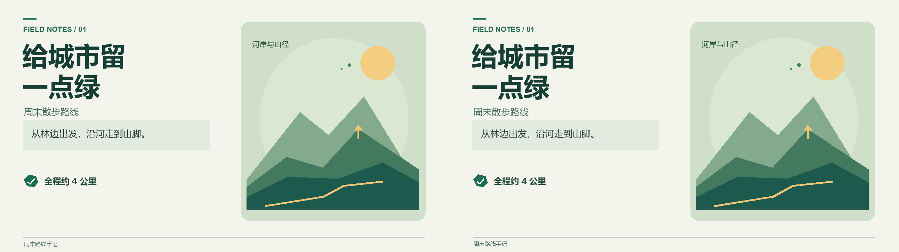
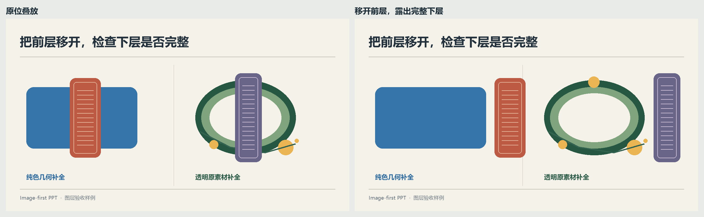

# Image-first PPT

先用整页图片定稿，再用 Codex 重建可编辑的 PowerPoint。标题和正文保留为原生文本，复杂插画、照片和图标从原图拆成可移动图片，能贴合原图的简单形状可以直接修改外观。

## 快速开始

1. [下载技能安装包](https://github.com/Fan-Fan-F/image-first-ppt/releases/latest/download/image-first-ppt-skill.zip)。
2. 把安装包交给 Codex，说「帮我安装这个 Skill 到我的 Codex 用户技能目录，并检查本地运行依赖」。手工安装时，把解压得到的 `image-first-ppt` 文件夹放入当前环境的技能目录。
3. 在 Codex 里提供图片文件，或告诉它主题、受众和页数，再使用以下示例中的一条指令。Codex 会处理清点、构建和校验。

> 用 $image-first-ppt 把我附上的图片重建成可编辑 PPT。保留原版式，小图标和脚注也要逐页对照。

> 用 $image-first-ppt 做一套 6 页的 PPT。先生成整页图片定版，再重建原生文字与可移动图层。

如果希望在 ChatGPT 网页版先生图或清点，可使用 [网页版交接提示词](references/chatgpt-handoff.md)，下载图片和清单后再交给 Codex。这个流程支持手工交接，尚未用真实网页会话完成端到端验证。

## 看一个样例

左边是原图，右边是桌面 PowerPoint 导出的重建结果。中文版合成样页有 8 个原生文本框、2 张独立图片和 1 个原生形状，可以下载后直接点选、编辑和移动。

[下载可编辑 PowerPoint 样页](examples/demo.pptx) · [打开完整对比图](examples/before-after.png)

## 重叠图案也能完整拖开

v1.1 将下层图案的可见像素和被挡住的部分分开处理。左边的蓝卡按完整轮廓补齐，右边的绿色图案使用完整透明原件，保留中间镂空。对比图的右半是移开两块前层图案后，由桌面 PowerPoint 导出的结果。

[下载重叠样页，试着拖走橙色和紫色前层](examples/overlap.pptx) · [查看完整图层的清单和验收方法](references/completing-layers.md)

## 重建和检查

- 锁定原图尺寸和坐标，搭配带像素标尺的重叠裁片寻找小图标、细线和脚注。
- 从原图像素制作图层，按遮罩局部清除文字或修补底图。可单独采样字色，匹配本机中英文字体和字重。
- 检查 PPTX 中的元素、坐标和可编辑文字。用真实渲染和差异图复核画面，再检查移动图层后是否露出残影。
- 从原始表格和权威来源建立数值清单，替换图稿里的柱形图、条形图、折线图和 XY 图。原生图表可以在 PowerPoint 里用「编辑数据」修改，校验脚本会同时核对图表显示的数据和内嵌 Excel 工作簿。[数据审查与原生图表](references/native-charts.md)

本地脚本通过 Python 3.10 或更新版本运行，[依赖清单](requirements.txt)列出了所需库，无需模型 API。桌面 PowerPoint 渲染已在 Windows 上验证。其它环境可以做结构检查，也可以提供同尺寸的渲染图进行比较。准确恢复被遮挡部分需要原素材，原生图表需要经过核对的数据。

[技能说明](SKILL.md) · [清单、命令和校验](references/scene.md) · [相关项目](references/research.md) · [版本记录](CHANGELOG.md) · [MIT 许可证](LICENSE)

运行回归测试可用 `python -m unittest discover -s tests`。
